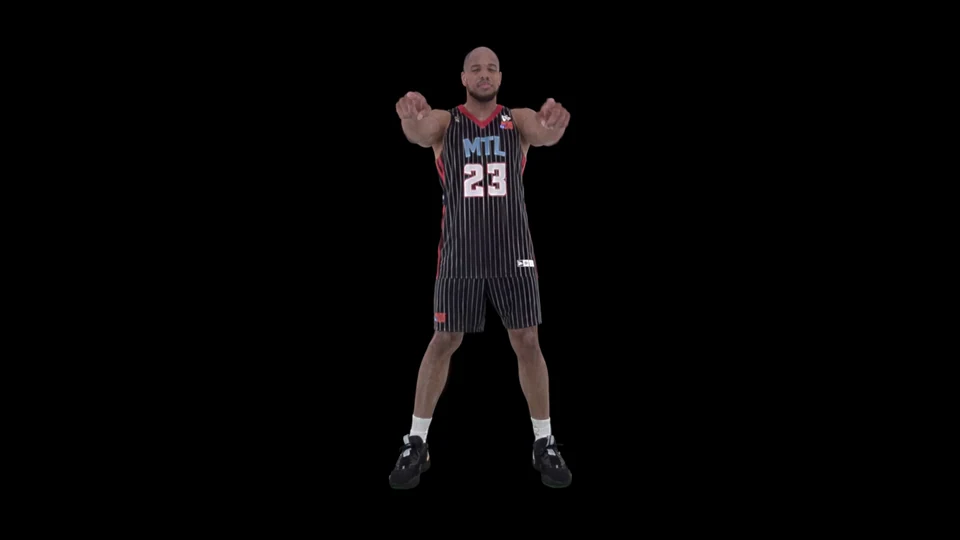

# PrismSplat

**A native Metal renderer for 3D Gaussian splatting and 4D Gaussian splat video on Apple Vision Pro and Mac.**

Use PrismSplat from Swift to render a Gaussian splat scene or play a sequence of changing geometry. Metal culls and sorts splats on the GPU, then draws from the current camera pose in mono or stereo. The viewer can change perspective independently of the animation.

[Install](#install) · [Basketball demo](#basketball-demo) · [Play Gaussian splat video](#play-gaussian-splat-video) · [Apple platform support](#apple-platform-support)

## Basketball demo

[](media/basketball-mac.mp4)

Prism streams this SOG 3 sequence at 15 geometry frames per second with 72,000 splats per frame. The preview was rendered with PrismSplat on an M3 Max MacBook Pro, and we tested the same sequence on Apple Vision Pro. [Watch the Mac render](media/basketball-mac.mp4)

Original volumetric capture by GeniusXR (Azad Abbasi). [PlayCanvas source demo](https://playcanvas.github.io/#/gaussian-splatting/flipbook)

## Apple platform support

| Platform | Minimum version | Rendering |
| --- | --- | --- |
| **Apple Vision Pro** | visionOS 2 | Stereo Gaussian splats with per-eye views and projections. The indexed path accepts rasterization-rate maps. |
| **Mac with Apple silicon** | macOS 15 | Mono and stereo camera views in native Metal. |
| **iPhone and iPad** | iOS 18 | Native Metal rendering on supported devices. |

PrismSplat is a Swift 6 package. The indexed renderer supports indirect draws and optional geometry LOD for static scenes. The screen-space renderer composites fine and coarse tiles front to back and falls back to indexed drawing when its tile index exceeds capacity.

## Install

In Xcode, choose **File → Add Package Dependencies**, enter `https://github.com/ferdinandl007/PrismSplat.git`, and add the **PrismSplat** product.

For Swift Package Manager, add the dependency to `Package.swift` and the product to your target.

```swift
.package(url: "https://github.com/ferdinandl007/PrismSplat.git", from: "0.2.0")
```

```swift
.product(name: "PrismSplat", package: "PrismSplat")
```

## Play Gaussian splat video

PrismSplat renders prepared Gaussian frames using one persistent Metal renderer. Set up the renderer with geometry LOD disabled, then reuse its frame preparation closure to stage upcoming frames off the render path. Each frame uses the renderer’s original splat count.

```swift
let prepareFrame = try renderer.framePreparation()

// Prepare an upcoming capture on a worker.
let prepared = try prepareFrame(upcomingCapture)

// Queue the upload before sorting and drawing.
try renderer.encodeFrame(prepared, on: commandBuffer)
try renderer.render(eyes: eyes, color: target, on: commandBuffer)
```

Use `prepared.byteCount` to cap the size of your playback buffer. Keeping only the current frame and a few upcoming frames in memory lets a long clip exceed GPU memory. The host app supplies downloading, decoding, frame timing, and camera tracking.

The **Prism app** combines this rendering approach with HTTPS streaming of [SOG 3](https://developer.playcanvas.com/user-manual/gaussian-splatting/formats/sog/) frame sequences. Prism can load a short loop into memory or keep a rolling window of a longer segmented stream. The Swift package reads Gaussian splat PLY and LZFSE-compressed PLY. SOG decoding and the streaming player are part of the Prism app.

## Render a static scene

Load a binary little-endian Gaussian splat PLY with float32 fields, or its LZFSE-compressed equivalent at a `.lzfse` URL. The importer accepts spherical harmonic degrees 0 through 3. The renderer evaluates DC and first-order coefficients.

```swift
import Metal
import PrismSplat

let capture = try await SplatFile.read(from: sceneURL, limit: 400_000)
let renderer = try MetalSplatRenderer(
    device: device,
    capture: capture,
    color: .bgra8Unorm_srgb,
    maxViews: 1
)

try renderer.render(eyes: [eye], color: target, on: commandBuffer)
```

Supply one `MetalSplatRenderer.Eye` per view. The view matrix transforms scene coordinates into camera space looking down −Z, and the Metal projection uses a clip-space depth range of 0 to 1. Encode work for each renderer serially on the same Metal command queue.

- For layered stereo, use `maxViews: 2` and a two-slice texture array. The two eye descriptions supply their respective viewports and matrices.
- For separate eye targets, call `encodeSort(eyes:on:)` once with both eyes and then `draw(eyes:color:on:)` with each eye and its own target.
- For screen-space tiles, use `screenTiles: true` and `MetalSplatRenderer.ScreenTileRenderer(base:)`. Set `referenceLimit` to bound tile-index memory.

## Test and license

Run `swift test` on an Apple silicon Mac. The tests check PLY parsing, indexed drawing, tile compositing and fallback, stereo texture slices, and updates to animated geometry.

PrismSplat is available under the [MIT License](LICENSE). See [NOTICE](NOTICE) for attribution to Sean Cier’s MetalSplatter.
